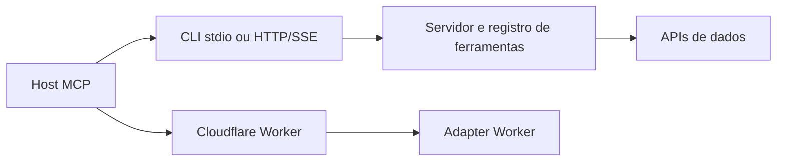
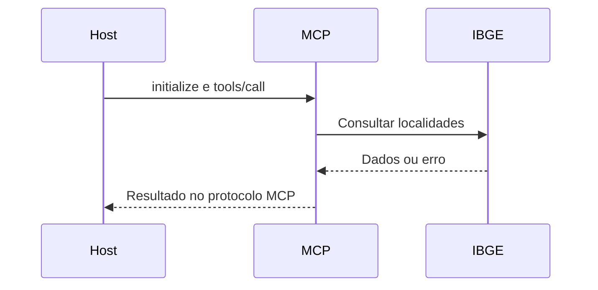

# Arquitetura AS-IS

Base inicial: `037dae4c`.

O CLI conecta o servidor MCP por stdio ou HTTP/SSE. Há um adapter separado no Cloudflare Worker. O servidor central consulta um registro de ferramentas por domínio.

## Fontes no snapshot inicial

- `lib/adapters/cli.ts:L166-L245`
- `lib/core/mcp-server.ts:L22-L64`
- `lib/workers/worker.ts:L68-L92`
- `lib/tools/government.ts:L11-L32`

## Explorador do IBGE no CLI

`lib/core/mcp-server.ts` publica um recurso MCP Apps `ui://` associado à ferramenta `ibge_localidades`. O mesmo servidor atende stdio e HTTP/SSE. O build em `scripts/build-apps.mjs` gera o HTML autônomo distribuído com o pacote. A UI em `apps/ibge/main.ts` consulta a ferramenta pelo host. O Worker tem registro próprio e segue com resultado textual.

### MCP App do Querido Diário

O servidor Node registra `ui://dadosbr/querido-diario.html` para `querido_diario` em stdio e HTTP/SSE. O painel compartilhado também funciona dentro do Explorador e encaminha o identificador IBGE selecionado como `territory_id`. A API do provedor recebe `territory_ids`, `published_since` e `published_until`. O contrato textual permanece disponível no Node e no Worker; a negociação de MCP Apps acrescenta proveniência ao resultado estruturado.

### MCP App do Banco Central

O servidor Node associa `bacen_taxas` a `ui://dadosbr/banco-central.html`. O painel usa as cinco séries existentes do SGS e aceita períodos de 30, 90 ou 365 dias com consulta explícita até o dia corrente em São Paulo. O fluxo legado mantém o envelope textual de `ultimos`; clientes com a extensão recebem o mesmo conteúdo e a proveniência estruturada. O navegador oferece gráfico e tabela. O Worker mantém a resposta textual.

### MCP App de editais do PNCP

O servidor Node registra `ui://dadosbr/editais-pncp.html` por `pncp_licitacoes`. O modo de publicações transmite CNPJ opcional, período e modalidade à API de Consulta e usa o domínio do PNCP para os links dos editais. Respostas 204 são páginas vazias somente nesse modo. O caminho legado conserva o JSON e a busca do portal. Clientes do Worker recebem texto.

### MCP App de ficha por CNPJ

O servidor Node associa `cnpj_lookup` a `ui://dadosbr/ficha-cnpj.html`. A projeção seleciona situação, CNAEs, endereço e proveniência da resposta existente do provedor. O JSON textual e a validação original de CNPJ numérico são preservados. O Worker oferece retorno textual.
