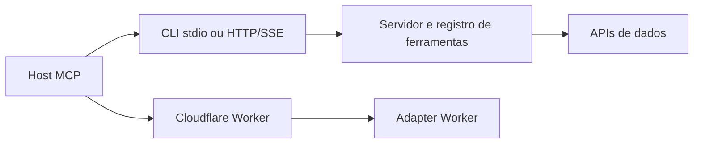
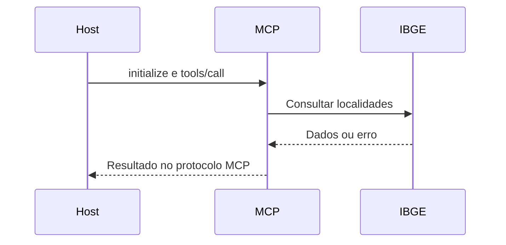

# Arquitetura AS-IS

Base revisada: `133dbd5` (`0.7.0`, branch `feature/SPC-0001-v0.7.0-transversal-sources` / `SPC-0001`; base inicial: `037dae4c`).

O CLI conecta o servidor MCP por stdio ou HTTP/SSE (`lib/adapters/cli-http.ts`, com métricas de execução emitidas em `stderr` para manter `stdout` exclusivo de JSON-RPC no transporte stdio). Há um adapter separado no Cloudflare Worker. O servidor central consulta o registro unificado de 29 ferramentas por domínio (`lib/core/registry.ts`, `lib/core/tools.ts`, barrel `lib/tools/index.ts`) e expõe cinco recursos MCP Apps (`ui://dadosbr/*.html`) no runtime Node, enquanto a automação de produção/sandbox opcional vive isolada em `infra/runner/`.

## Fontes

- `lib/adapters/cli.ts:L166-L245`
- `lib/core/mcp-server.ts:L17-L143`
- `lib/core/tools.ts:L27-L47`
- `lib/core/lookup.ts:L1-L87`
- `lib/core/intelligence.ts:L5,L219-L253,L458-L525`
- `lib/tools/core.ts:L6-L103`
- `lib/adapters/cloudflare.ts:L23-L58,L163,L184,L280`
- `lib/workers/worker.ts:L12-L115,L166`
- `lib/workers/sse.ts:L155-L185`
- `lib/workers/openapi.ts:L6,L14-L20`
- `lib/tools/government.ts:L12-L38`
- `scripts/build-apps.mjs:L1-L42`

## Explorador do IBGE no CLI

`lib/core/mcp-server.ts` publica um recurso MCP Apps `ui://` associado à ferramenta `ibge_localidades`. O mesmo servidor atende stdio e HTTP/SSE. O build em `scripts/build-apps.mjs` gera o HTML autônomo distribuído com o pacote. A UI em `apps/ibge/main.ts` consulta a ferramenta pelo host. O Worker tem registro próprio e segue com resultado textual.

### MCP App do Querido Diário

O servidor Node registra `ui://dadosbr/querido-diario.html` para `querido_diario` em stdio e HTTP/SSE. O painel compartilhado também funciona dentro do Explorador e encaminha o identificador IBGE selecionado como `territory_id`. A API do provedor recebe `territory_ids`, `published_since` e `published_until`. O contrato textual permanece disponível no Node e no Worker; a negociação de MCP Apps acrescenta proveniência ao resultado estruturado.

### MCP App do Banco Central

O servidor Node associa `bacen_taxas` a `ui://dadosbr/banco-central.html`. O painel usa as cinco séries existentes do SGS e aceita períodos de 30, 90 ou 365 dias com consulta explícita até o dia corrente em São Paulo. O fluxo legado mantém o envelope textual de `ultimos`; clientes com a extensão recebem o mesmo conteúdo e a proveniência estruturada. O navegador oferece gráfico e tabela. O Worker mantém a resposta textual.

### MCP App de editais do PNCP

O servidor Node registra `ui://dadosbr/editais-pncp.html` por `pncp_licitacoes`. O modo de publicações transmite CNPJ opcional, período e modalidade à API de Consulta e usa o domínio do PNCP para os links dos editais. Respostas 204 são páginas vazias somente nesse modo. O caminho legado conserva o JSON e a busca do portal. Clientes do Worker recebem texto.

### MCP App de ficha por CNPJ

O servidor Node associa `cnpj_lookup` a `ui://dadosbr/ficha-cnpj.html`. A projeção seleciona situação, CNAEs, endereço e proveniência da resposta existente do provedor. O JSON textual e a validação original de CNPJ numérico são preservados. O Worker oferece retorno textual.

## Confiabilidade de Transportes e KV (`TCK-0020` / `FND-0008`)

- **Worker SSE (`lib/workers/sse.ts`, `lib/workers/worker.ts`)**: `handleSSEEndpoint` usa `ReadableStream<Uint8Array>` (`highWaterMark: 16`) com `timeout` (`TIMEOUTS.SSE_CONNECTION_MS`) e heartbeat (`TIMEOUTS.PING_INTERVAL_MS`) sem limpeza prematura em `finally`, coordenando encerramento síncrono e idempotente (`cleanup(reason)` + `finally { resolveDone(); }`) via `request.signal` abort, `cancel()` do consumidor, erro ou timeout, descartando pings com `desiredSize <= 0` sob backpressure e propagando `ctx.waitUntil(donePromise)`. Comportamento em runtime edge de produção no Cloudflare Workers fica *a confirmar*.
- **KV TTL e Rate Limit (`lib/core/cache.ts`, `lib/workers/rate-limit.ts`, `wrangler.toml`)**: `KVCache.set` e `checkRateLimit` gravam com `expirationTtl` mínimo de `60` segundos (`MIN_KV_EXPIRATION_TTL_SECONDS`, requisito da API Cloudflare KV) e tratamento defensivo de JSON corrompido. `checkRateLimit` lê `TIMEOUTS.RATE_LIMIT_WINDOW_MS` dinamicamente, usa chaves em janela fixa (`rate_limit:<ip>:<bucket>`), prioriza `CF-Connecting-IP` e ignora `X-Forwarded-For` salvo opt-in `MCP_TRUST_X_FORWARDED_FOR="true"`. `wrangler.toml` mantém `MCP_CACHE` e `MCP_KV` no mesmo namespace ID separados por prefixo de chave; como o Cloudflare KV possui consistência eventual e não provê incremento atômico global entre POPs (*a confirmar* em tráfego distribuído), bursts simultâneos são best-effort até eventual adoção de binding nativo de Rate Limiting ou Durable Objects.
- **Timers e Graceful Shutdown no Node CLI (`lib/infrastructure/rate-limiter.ts`, `lib/adapters/cli-http.ts`, `lib/adapters/cli.ts`)**: `RateLimiter` utiliza `.unref?.()` no timer de limpeza e expõe `destroy()` + alias `dispose()`. O servidor HTTP+SSE do CLI aplica headers defensivos e validação `Host`/`Origin` antes do parser `express.json({ limit: "1mb" })`, captura o `http.Server` retornado por `app.listen` e unifica `SIGINT`/`SIGTERM` em `createGracefulShutdown` (drenando sessões SSE, conexões ociosas do servidor HTTP, `mcpServer.close()` e `cache.clear()` dentro de timeout limitado).

## Arquitetura em Camadas e Paridade Worker (`TCK-0024` / `FND-0012`)

- **Separação acíclica `lib/core` <- `lib/tools` (`ADR-0001`)**: `lookup()`, `deduplicate()` e `getPendingRequestCount()` residem em `lib/core/lookup.ts` (`L1-L87`). `lib/core/intelligence.ts` e `lib/tools/company.ts` consomem `core/lookup.ts` diretamente, eliminando qualquer import de `lib/tools/` dentro de `lib/core/`. `lib/tools/core.ts` consome `...CNPJ_INTELLIGENCE_TOOL` e `executeIntelligence` estaticamente (sem schema duplicado) mantendo apenas re-exports de `lookup`/`deduplicate`/`getPendingRequestCount` em `L103` para retrocompatibilidade dos testes. `executeIntelligenceInternal` normaliza `options.cnpj` via `normalizeCnpj` antes de acessar/gravar chaves `cnpj:<baseUrl>:<digits>`.
- **Paridade Node <-> Cloudflare Worker (`ADR-0002`)**: `SERVER.VERSION` em `lib/shared/utils/constants.ts:L37` e `SERVER_VERSION` em `lib/config/index.ts:L13` refletem `"0.7.0"` (mesma versão de `package.json`), propagada para `/`, `/health`, `/openapi.json` e eventos `/sse`. `GET /` em `lib/workers/worker.ts:L120` publica dinamicamente todas as 29 ferramentas de `TOOL_DEFINITIONS`. `syncWorkerEnv(env)` em `lib/adapters/cloudflare.ts:L40-L58` sincroniza a allowlist explícita (`TAVILY_API_KEY`, `PERPLEXITY_API_KEY`, `TRANSPARENCIA_API_KEY`, `DATAJUD_API_KEY`) para `process.env` no Worker sem vazar `MCP_API_KEY` ou bindings KV. Comportamento em runtime edge de produção no Cloudflare Workers fica *a confirmar*.

## Consolidação Wave 2 (`TCK-0033`–`TCK-0039`)

- **Contrato REST/OpenAPI & Limpeza (`TCK-0037` / `TCK-0035`)**: `lib/workers/types.ts` e `lib/workers/openapi.ts` importam `DORK_CATEGORIES` (10 categorias) e `SEARCH_PROVIDERS` diretamente de `lib/core/tool-schemas.ts` e espelham `SequentialThinkingSchema` em `/thinking`. `lib/workers/worker.ts` decodifica `decodeURIComponent` em `/cnpj|cep/:valor` (retornando `400` em encoding inválido) e expõe `privacy` (`PRIVACY.md` + `MCP_DPO_CONTACT`) em `GET /`; `lib/workers/rest.ts` mapeia `"not found"` para HTTP `404`, omite campos `undefined` no schema `.strict()` de `/intelligence`, valida JSON via `parseJsonBody` (`400 Invalid JSON payload`) e sanitiza erros internos `500` sem expor `error.message`. Legados removidos: `lib/workers/tokens.ts`, `smithery.config.js`, `getDorksByCategory`, `getPrioritizedDorks` e `logTimeoutConfig`.
- **Correlação `X-Request-Id` & Logger Unificado (`TCK-0038`)**: `worker.ts` propaga `requestContext` para `checkRateLimit`, `authenticateRequest` e os 4 handlers de `lib/workers/rest.ts` (`handleMCPRequest`). No Node CLI (`lib/adapters/cli-http.ts` -> `lib/core/mcp-server.ts`), `AsyncLocalStorage<RequestContext>` propaga o `requestId` de `POST /messages` sem introduzir imports `node:*` em `lib/core/`. `rate-limit.ts`, `search.ts` e `intelligence.ts` usam `createLogger` em JSON `stderr` com redação intacta, e `lib/core/tools.ts` emite `tool.executed` em nível `INFO`.
- **Guardrails Agênticos & Compliance LGPD (`TCK-0036` / `TCK-0033`)**: `lib/shared/agentic-guard.ts` delimita contexto de usuário/web não confiável (`<untrusted_user_context>`), sanitiza controle/HTML e limita payloads JSON de MCP (`serializeBoundedToolOutput`, `MCP_MAX_TOOL_OUTPUT_CHARS`); `PRIVACY.md`, `.archagents/10-runbooks.md` (Art. 48 ANPD) e `lib/shared/compliance-notices.ts` (`lgpd_notice`, Art. 20) documentam salvaguardas em consultas nominais/jurídicas. Comportamento no runtime Cloudflare em produção fica *a confirmar*.
