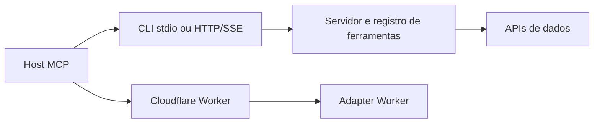
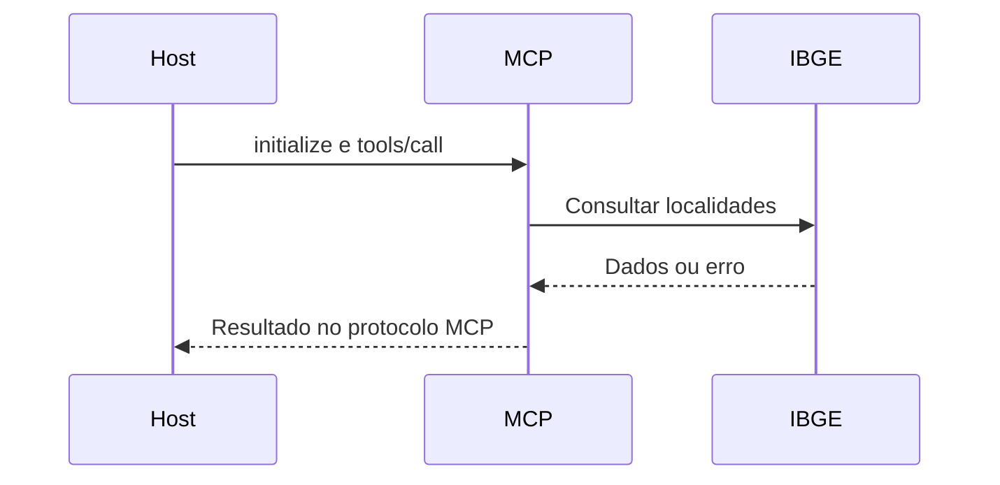

# Arquitetura AS-IS

Base inicial: `037dae4c`.

O CLI conecta o servidor MCP por stdio ou HTTP/SSE. Há um adapter separado no Cloudflare Worker. O servidor central consulta um registro de ferramentas por domínio.

## Fontes no snapshot inicial

- `lib/adapters/cli.ts:L166-L245`
- `lib/core/mcp-server.ts:L22-L64`
- `lib/workers/worker.ts:L68-L92`
- `lib/tools/government.ts:L11-L32`

## Explorador do IBGE no CLI

`lib/core/mcp-server.ts` publica um recurso MCP Apps `ui://` associado à ferramenta `ibge_localidades`. O mesmo servidor atende stdio e HTTP/SSE. O build em `scripts/build-apps.mjs` gera o HTML autônomo distribuído com o pacote. A UI em `apps/ibge/main.ts` consulta a ferramenta pelo host. O Worker tem registro próprio e segue com resultado textual.
