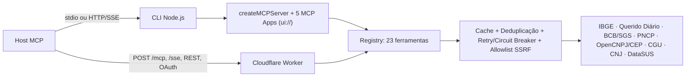

# MCP DadosBR `by Orqo`

**Dados públicos brasileiros na conversa com IA. Com fonte, proveniência e limites declarados.**

[](https://orqo.pro/)
[](https://www.npmjs.com/package/@aredes.me/mcp-dadosbr)
[](LICENSE)
[](package.json)
[](#os-5-mcp-apps-interativos)

[O problema](#o-problema) · [5 MCP Apps](#os-5-mcp-apps-interativos) · [23 ferramentas](#catálogo-completo-das-23-ferramentas) · [Perímetro](#perímetro-de-execução) · [Instalação](#instalação-e-configuração) · [Por dentro](#como-funciona-por-dentro) · [O que não faz](#honestidade-o-que-o-mcp-dadosbr-não-faz) · [Governança](#governança-construído-com-codebase-ops-by-orqo) · [AGPL-3.0](#licença-gnu-agpl-30) · [English](#english)

---

O **MCP DadosBR** é um servidor open source do [Model Context Protocol (MCP)](https://modelcontextprotocol.io/) desenvolvido pela [Orqo](https://orqo.pro/) que conecta assistentes de IA a **23 consultas de dados públicos brasileiros** — com **5 painéis interativos (MCP Apps)** para explorar municípios, diários oficiais, indicadores do Banco Central, editais do PNCP e fichas cadastrais de CNPJ diretamente na conversa.

- **Zero chave nos 5 MCP Apps e no CEP** — IBGE, Querido Diário, Banco Central, PNCP, OpenCNPJ e OpenCEP funcionam sem cadastro prévio.
- **Proveniência explícita** — URL consultada e horário da consulta no servidor (`fetchedAt`) nos 5 MCP Apps (`structuredContent`) e nas consultas de CNPJ/CEP (`source`/`fetchedAt`), com separação explícita entre `fetchedAt` e `updatedAt` na ficha cadastral.
- **Local ou na borda** — CLI Node.js (`stdio` e `HTTP/SSE`) com painéis interativos, ou Cloudflare Worker com retorno JSON, REST e OAuth.
- **Software livre AGPL-3.0 com rastro público** — desenvolvido e verificado com [Codebase OPS by Orqo](https://orqo.pro/).

---

## O problema

### Seu assistente sabe falar sobre o Brasil. Não sabe o estado atual de um CNPJ, de uma taxa do Banco Central ou de um edital publicado hoje.

Pedir dados públicos brasileiros "de memória" a um modelo de linguagem mistura fato, defasagem e suposição. Para due diligence, jornalismo de dados, compras públicas ou engenharia, texto fluente não substitui a consulta à fonte.

| Pedir ao LLM "de memória" | Consultar via MCP DadosBR `by Orqo` |
| --- | --- |
| Situação cadastral e CNAEs possivelmente defasados ou inventados | Consulta direta ao provedor declarado (`OpenCNPJ` ou allowlist HTTPS), com `provider`, `fetchedAt` e `updatedAt` separados |
| Taxas de Selic, IPCA e câmbio sem série ou janela verificável | Séries oficiais do **BCData/SGS** com ID da série, unidade e janela explícita (`30`, `90` ou `365` dias até hoje em São Paulo) |
| Editais e diários oficiais sem link verificável | Publicações consultadas na API do **PNCP** (links em `pncp.gov.br`) e no **Querido Diário** (edição original) |
| Erro silencioso ou preenchimento de lacunas com palpite | Erro explícito (`isError: true`) ou fallback com URL oficial quando o provedor falha ou exige CAPTCHA |
| Apenas texto corrido para listas, gráficos e cadastros | **5 MCP Apps interativos** (`ui://dadosbr/*.html`) na conversa + retorno JSON preservado para qualquer cliente MCP |

---

## Os 5 MCP Apps interativos

Os cinco painéis implementam a extensão [MCP Apps](https://modelcontextprotocol.io/extensions/apps/overview) (`mimeType: text/html;profile=mcp-app`), são empacotados como HTML autônomo em `build/lib/apps/*.html` e já acompanham o pacote npm a partir da versão `0.5.0`.

| MCP App | Ferramenta | Recurso `ui://` | O que você faz no painel | Fonte dos dados |
| --- | --- | --- | --- | --- |
| **Localidades do IBGE** | `ibge_localidades` | `ui://dadosbr/ibge-localidades.html` | Navega por 5 macro-regiões, 27 UFs e ~5.570 municípios, filtra por nome ou código IBGE e abre diretamente o painel de diários oficiais do município selecionado. | [API de Localidades do IBGE](https://servicodados.ibge.gov.br/api/v1/localidades/estados) |
| **Querido Diário** | `querido_diario` | `ui://dadosbr/querido-diario.html` | Pesquisa publicações em diários oficiais municipais por termo, `territory_id` (código IBGE) e período (`since`/`until`), ou lista edições recentes, com link para a edição original. | [API pública do Querido Diário](https://docs.queridodiario.ok.org.br/pt-br/latest/utilizando/api-publica.html) |
| **Indicadores do Banco Central** | `bacen_taxas` | `ui://dadosbr/banco-central.html` | Visualiza gráfico e tabela para **Meta Selic** (`432`), **IPCA** (`433`), **Dólar venda** (`1`), **Euro venda** (`21619`) e **CDI** (`12`) em janelas de `30`, `90` ou `365` dias até o dia corrente em São Paulo. | [Banco Central — BCData/SGS](https://www3.bcb.gov.br/sgspub/) |
| **Editais do PNCP** | `pncp_licitacoes` | `ui://dadosbr/editais-pncp.html` | Filtra publicações da Lei 14.133/2021 por período, modalidade (20 modalidades oficiais, ex.: `6` = Pregão Eletrônico) e CNPJ opcional do órgão, com links permanentes no portal oficial. | [API de Consultas do PNCP](https://pncp.gov.br/api/consulta/swagger-ui/index.html) |
| **Ficha por CNPJ** | `cnpj_lookup` | `ui://dadosbr/ficha-cnpj.html` | Exibe razão social, nome fantasia, situação cadastral e data, CNAE principal e secundários, endereço, hostname do provedor, horário da consulta (`fetchedAt`) e data de atualização cadastral (`updatedAt`) quando informada. | [OpenCNPJ](https://opencnpj.org/) por padrão ou [provedor compatível](lib/config/index.ts#L17-L26) |

### Experimente em uma conversa

1. **Explorar municípios e ir para o diário oficial (IBGE → Querido Diário):**
   > *"Abra o Explorador do IBGE para Alagoas, selecione Batalha, clique em Ver publicações e busque por orçamento."*
2. **Inspecionar uma ficha cadastral com proveniência:**
   > *"Abra a ficha do CNPJ 00.394.460/0001-41 e mostre situação cadastral, CNAEs, endereço e o provedor que respondeu."*
3. **Acompanhar uma série econômica oficial:**
   > *"Abra o painel do Banco Central e mostre a Selic dos últimos 90 dias com a série e a fonte."*
4. **Filtrar editais públicos:**
   > *"Abra o painel do PNCP e liste editais de pregão eletrônico publicados nos últimos 30 dias."*
5. **Cruzar dados de compliance (ferramentas textuais):**
   > *"Monte um perfil completo do CNPJ 00.394.460/0001-41 verificando contrato federal, sanções e WHOIS do domínio."*

---

## Catálogo completo das 23 ferramentas

Todas as 23 ferramentas registradas em [`lib/tools/index.ts`](lib/tools/index.ts) respondem em JSON estruturado no conteúdo textual (`content[0].text`). As cinco marcadas com **MCP App** também entregam `structuredContent` e painel HTML quando o cliente suporta `io.modelcontextprotocol/ui`.

### Cadastro, endereços e validação (3)

| Ferramenta | Descrição | Fonte | MCP App | Credencial |
| --- | --- | --- | --- | --- |
| `cnpj_lookup` | Dados cadastrais de empresa brasileira por CNPJ (com ou sem máscara). | OpenCNPJ (padrão) ou allowlist | **Sim** | Sem chave |
| `cep_lookup` | Endereço completo por CEP brasileiro (com ou sem máscara). | OpenCEP (padrão) ou allowlist | Texto | Sem chave |
| `cpf_validate` | Valida dígito verificador (mod-11), formata e informa a região fiscal do 9º dígito. | Cálculo local | Texto | Sem chave |

### Governo, diários e contratações (5)

| Ferramenta | Descrição | Fonte | MCP App | Credencial |
| --- | --- | --- | --- | --- |
| `ibge_localidades` | Lista regiões (`regioes`), estados (`estados`), todos os municípios (`municipios`) ou por UF (`municipios_por_uf`). | API de Localidades do IBGE | **Sim** | Sem chave |
| `querido_diario` | Busca publicações em diários oficiais municipais por texto, `territory_id`, `since`, `until`, `page`, `size`. | Open Knowledge Brasil | **Sim** | Sem chave |
| `pncp_licitacoes` | Consulta publicações filtradas (`modalidade_id`, `data_inicial`, `data_final`, `cnpj_orgao`, `query: ""`) ou busca legada por termo. | PNCP (Lei 14.133/2021) | **Sim** | Sem chave |
| `transparencia_lookup` | Consulta `contratos`, `licitacoes`, `convenios`, `servidores` ou `sancoes` federais por CNPJ/CPF e período. | Portal da Transparência (CGU) | Texto | `TRANSPARENCIA_API_KEY` |
| `ceis_cnep_lookup` | Verifica sanções em **CEIS**, **CNEP** e **CEPIM** (`tipo: ceis\|cnep\|cepim\|all`). Sem chave, retorna URLs de consulta manual. | Portal da Transparência (CGU) | Texto | `TRANSPARENCIA_API_KEY` (opcional com fallback manual) |

### Financeiro e mercado (2)

| Ferramenta | Descrição | Fonte | MCP App | Credencial |
| --- | --- | --- | --- | --- |
| `bacen_taxas` | Séries `selic`, `ipca`, `dolar`, `euro` e `cdi` por `ultimos` pontos ou `periodo_dias` (`30`, `90`, `365`). | Banco Central — BCData/SGS | **Sim** | Sem chave |
| `fipe_veiculos` | Consulta preços por `codigo_fipe` ou lista marcas por `tipo` (`carros`, `motos`, `caminhoes`). | Tabela FIPE via BrasilAPI | Texto | Sem chave |

### Jurídico, compliance e integridade (5)

| Ferramenta | Descrição | Fonte | MCP App | Credencial |
| --- | --- | --- | --- | --- |
| `datajud_processos` | Busca processos judiciais em 17 tribunais mapeados (`tst`, `trf1`–`trf5`, `tjsp`, `tjrj`, `tjmg`, `tjrs`, `tjpr`, `tjsc`, `tjba`, `tjpe`, `tjce`, `tjgo`, `tjdf`). | API Pública DataJud (CNJ) | Texto | `DATAJUD_API_KEY` |
| `oab_advogado` | Consulta o Cadastro Nacional dos Advogados por `nome`, `inscricao` e `uf`. Retorna link manual quando bloqueado por CAPTCHA. | OAB — CNA | Texto | Sem chave (sujeito a CAPTCHA) |
| `bnmp_mandados` | Consulta mandados de prisão por `nome` e `orgaoJulgador`. Retorna link manual quando bloqueado por CAPTCHA. | CNJ — BNMP | Texto | Sem chave (sujeito a CAPTCHA) |
| `procurados_lookup` | Busca por correspondência parcial na lista federal de procurados (~195 registros). | MJSP — Projeto Captura | Texto | Sem chave |
| `lista_suja_lookup` | Verifica o cadastro de empregadores em trabalho análogo à escravidão (com fallback para links oficiais). | Portal da Transparência / MTE | Texto | Sem chave |

### Saúde e consumo (2)

| Ferramenta | Descrição | Fonte | MCP App | Credencial |
| --- | --- | --- | --- | --- |
| `cnes_saude` | Busca estabelecimentos (`estabelecimento`) ou profissionais (`profissional`) por código CNES, nome, UF ou município (códigos IBGE). | CNES — DataSUS | Texto | Sem chave |
| `consumidor_reclamacoes` | Consulta indicadores de reclamações por nome da empresa (com fallback para dados abertos). | Consumidor.gov.br — SENACON | Texto | Sem chave |

### Inteligência, busca web, domínio e raciocínio (6)

| Ferramenta | Descrição | Fonte | MCP App | Credencial |
| --- | --- | --- | --- | --- |
| `cnpj_search` | Pesquisa web com dorks e filtros direcionados sobre empresas e CNPJs. | Tavily / Perplexity | Texto | `TAVILY_API_KEY` ou `PERPLEXITY_API_KEY` |
| `cnpj_intelligence` | Pesquisa automatizada multi-categoria por CNPJ com limite de concorrência configurável. | Tavily / Perplexity + CNPJ | Texto | `TAVILY_API_KEY` ou `PERPLEXITY_API_KEY` |
| `company_deep_profile` | Orquestra em paralelo `cnpj_lookup`, `transparencia_lookup`, `datajud_processos`, `domain_whois`, `lista_suja_lookup` e `cnpj_search`, listando fontes consultadas e indisponíveis. | Múltiplas fontes acima | Texto | Usa chaves configuradas |
| `domain_whois` | Consulta registro de domínio via RDAP (`.br` no Registro.br com fallback IANA RDAP). | Registro.br / RDAP.org | Texto | Sem chave |
| `strategic_osint_prompt` | Gera roteiros estruturados de análise (`due_diligence`, `competitor_analysis`, `fraud_detection`, `esg_compliance`, `investment_screening`) referenciando as ferramentas do servidor. | Templates locais | Texto | Sem chave |
| `sequentialthinking` | Auxilia decomposição passo a passo e revisão de hipóteses em investigações complexas. | Processamento local | Texto | Sem chave |

---

## Perímetro de execução

### A mesma disciplina de dados, no ambiente que a sua operação exigir.

O que muda entre os modos é onde o servidor executa e se o cliente recebe os painéis HTML interativos — não a validação de entrada nem a separação entre dado e erro.

| Modo | Transporte | MCP Apps (`ui://`) | Retorno JSON textual | Controles inclusos | Quando escolher |
| --- | --- | --- | --- | --- | --- |
| **CLI local (padrão)** | `stdio` | **Sim (5 apps)** | Sim (23 ferramentas) | `stdout` reservado para JSON-RPC, cache em memória, deduplicação, retry + circuit breaker, allowlist SSRF | Uso local no Claude Desktop, Cursor, Windsurf, Claude Code e demais hosts desktop |
| **CLI HTTP/SSE local** | `GET /mcp` + `POST /messages` | **Sim (5 apps)** | Sim (23 ferramentas) | Rate limit (30 req/min por IP), limpeza de sessões SSE inativas, CORS | Rede local, Docker, VPS própria ou clientes MCP remotos com suporte a SSE |
| **Cloudflare Worker** | `POST /mcp`, `/sse`, REST e OAuth | Não (somente texto) | Sim | Autenticação/OAuth, rate limit na borda, `GET /health`, OpenAPI | Conectores remotos serverless e integrações HTTP sem manter servidor dedicado |

**O que não muda entre os modos:**

- Validação de CNPJ/CEP/datas e allowlist HTTPS para hosts configuráveis (proteção SSRF).
- Retorno textual JSON completo para todas as ferramentas.
- Distinção explícita entre resultado do provedor, ausência de credencial e falha de consulta.
- Credenciais sempre injetadas por ambiente ou configuração local fora do Git.

---

## Instalação e configuração

**Pré-requisito:** Node.js **22.12 ou posterior na linha 22**, **24** ou **26** (`engines.node` em [`package.json`](package.json#L110)).

### 1. Início rápido via npm (recomendado — versão `0.5.0` inclui os 5 MCP Apps)

Em clientes que utilizam `mcpServers` (Claude Desktop, Cursor, Windsurf, Claude Code e compatíveis), adicione:

```json
{
  "mcpServers": {
    "dadosbr": {
      "command": "npx",
      "args": ["-y", "@aredes.me/mcp-dadosbr"]
    }
  }
}
```

> Para fixar a versão com os cinco painéis empacotados, use `"@aredes.me/mcp-dadosbr@0.5.0"`. O pacote publicado no [npm](https://www.npmjs.com/package/@aredes.me/mcp-dadosbr) e o [release v0.5.0 no GitHub](https://github.com/cristianoaredes/mcp-dadosbr/releases/tag/v0.5.0) distribuem os cinco HTMLs em `build/lib/apps/`.

### 2. A partir do código-fonte (desenvolvimento, auditoria ou customização)

```bash
git clone https://github.com/cristianoaredes/mcp-dadosbr.git
cd mcp-dadosbr
npm ci
npm run build
```

Configure seu cliente apontando para o caminho absoluto do build:

```json
{
  "mcpServers": {
    "dadosbr": {
      "command": "node",
      "args": ["/caminho/absoluto/mcp-dadosbr/build/lib/adapters/cli.js"]
    }
  }
}
```

### 3. Modo servidor HTTP/SSE local

```bash
MCP_TRANSPORT=http MCP_HTTP_PORT=3000 npx -y @aredes.me/mcp-dadosbr
```

O servidor abre o stream SSE em `GET http://127.0.0.1:3000/mcp` e recebe mensagens JSON-RPC em `POST http://127.0.0.1:3000/messages?sessionId=<id>`, com rate limit de **30 requisições por minuto por IP** ([`lib/adapters/cli.ts`](lib/adapters/cli.ts#L93-L239)).

### 4. Provedor customizado de CNPJ ou CEP (`.mcprc.json` ou variável de ambiente)

A hierarquia de configuração em [`lib/config/index.ts`](lib/config/index.ts#L76-L137) é: **variáveis de ambiente > `.mcprc.json` no diretório atual > padrões (`OpenCNPJ` e `OpenCEP`)**.

Exemplo com variável de ambiente (ex.: CNPJ.ws):

```json
{
  "mcpServers": {
    "dadosbr": {
      "command": "npx",
      "args": ["-y", "@aredes.me/mcp-dadosbr"],
      "env": {
        "CNPJ_API_BASE_URL": "https://publica.cnpj.ws/cnpj/",
        "TRANSPARENCIA_API_KEY": "sua-chave-opcional"
      }
    }
  }
}
```

Ou crie um `.mcprc.json` baseado em [`.mcprc.example.json`](.mcprc.example.json):

```json
{
  "apiUrls": {
    "cnpj": "https://publica.cnpj.ws/cnpj/",
    "cep": "https://viacep.com.br/ws/"
  },
  "auth": {
    "headers": {
      "X-API-Key": "sua-chave-se-o-provedor-exigir"
    }
  }
}
```

**Hosts permitidos na allowlist SSRF** ([`lib/config/index.ts`](lib/config/index.ts#L17-L35) — somente HTTPS, exceto `localhost`/`127.0.0.1`):

- **CNPJ:** `api.opencnpj.org`, `receitaws.com.br`, `www.receitaws.com.br`, `brasilapi.com.br`, `publica.cnpj.ws`, `minhareceita.org`, `localhost`, `127.0.0.1`
- **CEP:** `opencep.com`, `viacep.com.br`, `brasilapi.com.br`, `cep.awesomeapi.com.br`, `localhost`, `127.0.0.1`

### 5. Referência de variáveis de ambiente

| Variável | Padrão | Uso |
| --- | --- | --- |
| `TRANSPARENCIA_API_KEY` | *(nenhum)* | Habilita `transparencia_lookup` e consultas diretas em `ceis_cnep_lookup` (chave gratuita no Portal da Transparência). |
| `DATAJUD_API_KEY` | *(nenhum)* | Habilita `datajud_processos` na API Pública do CNJ. |
| `TAVILY_API_KEY` | *(nenhum)* | Provedor prioritário de busca web em `cnpj_search`, `cnpj_intelligence` e `company_deep_profile`. |
| `PERPLEXITY_API_KEY` | *(nenhum)* | Provedor alternativo de busca web quando configurado. |
| `CNPJ_API_BASE_URL` | `https://api.opencnpj.org/` | URL base HTTPS para `cnpj_lookup` (deve estar na allowlist). |
| `CEP_API_BASE_URL` | `https://opencep.com/v1/` | URL base HTTPS para `cep_lookup` (deve estar na allowlist). |
| `API_KEY_HEADER` / `API_KEY_VALUE` | *(nenhum)* | Cabeçalho de autenticação enviado ao provedor customizado de CNPJ/CEP. |
| `MCP_TRANSPORT` | `stdio` | Modo de transporte do CLI: `stdio` ou `http` (HTTP/SSE). |
| `MCP_HTTP_PORT` | `3000` | Porta TCP usada quando `MCP_TRANSPORT=http`. |
| `MCP_CACHE_SIZE` / `MCP_CACHE_TTL` | `256` / `3600000` ms | Capacidade e TTL (ms) do cache em memória do CLI. |
| `MCP_CACHE_BACKGROUND_CLEANUP` | `false` | Se `true`, ativa limpeza periódica em segundo plano do cache. |
| `MCP_API_TIMEOUT` | `8000` ms | Timeout (ms) das requisições HTTP de saída. |
| `MCP_INTELLIGENCE_CONCURRENCY` | `3` | Limite de buscas simultâneas em `cnpj_intelligence`. |
| `DISABLE_THOUGHT_LOGGING` | `false` | Se `true`, suprime log de pensamentos de `sequentialthinking` no `stderr`. |
| `NODE_ENV` | *(não definido)* | Em `production`, desativa logs `[DEBUG]` no `stderr` e mascara IPs nas mensagens de rate limit. |

Para deploy serverless no Cloudflare Workers, consulte [`docs/CONFIGURATION.md`](docs/CONFIGURATION.md) e os scripts `npm run build:worker`, `npm run deploy` e `npm run deploy:staging`.

---

## Como funciona por dentro



- **Contrato `structuredContent` + fallback textual ([`lib/core/mcp-server.ts`](lib/core/mcp-server.ts#L109-L143)):** toda chamada bem-sucedida devolve o JSON serializado em `content[0].text`. Quando o cliente negocia `extensions["io.modelcontextprotocol/ui"]` com `text/html;profile=mcp-app`, o servidor acrescenta `structuredContent`: `{ items, source }` no IBGE, `{ ...result.data, provenance: result.source }` em Querido Diário/BACEN/PNCP, e `{ profile }` (via [`readCnpjProfile`](lib/shared/cnpj-profile.ts)) no CNPJ.
- **Integridade do transporte `stdio` ([`lib/core/tools.ts`](lib/core/tools.ts#L27-L34)):** `stdout` é reservado exclusivamente a mensagens JSON-RPC; logs de inicialização, depuração e métricas periódicas (a cada 100 requisições) são gravados em `stderr`. O teste [`test/integration/transports.mjs`](test/integration/transports.mjs#L81-L94) valida 101 chamadas consecutivas sem erro de enquadramento.
- **Resiliência HTTP ([`lib/core/http-client.ts`](lib/core/http-client.ts)):** backoff exponencial (1s, 2s, 4s) para erros transitórios (`429`, `500`, `502`, `503`, `504` e falhas de rede), circuit breaker global, deduplicação de requisições em andamento (janela de 30s em `cnpj_lookup`/`cep_lookup`) e tratamento explícito de HTTP `204` como página vazia no modo filtrado do PNCP.
- **Empacotamento seguro dos MCP Apps ([`scripts/build-apps.mjs`](scripts/build-apps.mjs#L13-L42)):** `esbuild` gera bundles IIFE minificados e embute CSS/JS nos templates HTML verificando marcadores obrigatórios e bloqueando `</script` ou `</style` no conteúdo inline.

---

## Honestidade: o que o MCP DadosBR não faz

Esta seção existe para evitar expectativas erradas antes da adoção.

- **Não garante disponibilidade nem cobertura completa das APIs públicas.** Provedores governamentais e comunitários sofrem instabilidades e têm cobertura desigual — por exemplo, o Querido Diário cobre apenas municípios integrados ao projeto; CNES e Consumidor.gov.br podem cair para URLs de consulta manual.
- **Não fabrica data de atualização cadastral.** Na ficha por CNPJ, `fetchedAt` registra quando o servidor consultou o provedor; `updatedAt` só aparece quando o próprio provedor devolve essa informação.
- **Não consulta CPF na Receita Federal.** `cpf_validate` roda 100% localmente, validando apenas o dígito verificador (mod-11) e a região fiscal do 9º dígito — não confirma existência nem titularidade.
- **Não burla CAPTCHAs nem faz scraping autenticado.** Quando portais como OAB/CNA ou BNMP exigem CAPTCHA, a ferramenta devolve o link oficial e os passos manuais em vez de tentar contornar o bloqueio.
- **Não aceita endpoints arbitrários de CNPJ ou CEP.** URLs fora da allowlist HTTPS de [`lib/config/index.ts`](lib/config/index.ts#L17-L35) são recusadas na inicialização para mitigar SSRF.
- **Não entrega painéis HTML interativos no Cloudflare Worker.** Os cinco recursos `ui://dadosbr/*.html` rodam no servidor Node.js (`stdio` e `HTTP/SSE`); o Worker serve o retorno textual JSON, REST e OAuth.
- **Não substitui assessoria jurídica, auditoria formal ou certificação de compliance.** Entrega dados verificáveis com fonte para subsidiar decisão humana.

---

## Governança: construído com Codebase OPS by Orqo

O MCP DadosBR é um projeto da **[Orqo](https://orqo.pro/)** e um caso público de desenvolvimento governado pelo **[Codebase OPS by Orqo](https://orqo.pro/)**. Em vez de deixar decisões perdidas em conversas de chat, o repositório guarda o rastro verificável em [`.archagents/`](.archagents/README.md): pedido → design → execução → verificação independente.

Exemplos auditáveis no histórico deste repositório:

- **[PR #12 — Bootstrap e governança inicial](https://github.com/cristianoaredes/mcp-dadosbr/pull/12):** fotografia AS-IS do código existente, estrutura `.archagents/` e configuração do CI.
- **[PR #18 — MCP App de ficha por CNPJ](https://github.com/cristianoaredes/mcp-dadosbr/pull/18):** entrega ponta a ponta ligada a `TCK-0005`, `DES-0005`, run de execução e parecer independente.
- **[PR #20 — Release `v0.5.0` e correção `TCK-0007`](https://github.com/cristianoaredes/mcp-dadosbr/pull/20):** durante a verificação independente da documentação (`VER-20261118-030814-tck-0006`), uma sequência de 101 chamadas `stdio` detectou uma linha de métricas vazando em `stdout` e quebrando o JSON-RPC — o defeito virou o ticket `TCK-0007`, foi corrigido com teste de regressão e só então a `v0.5.0` foi liberada com gate de CI por SHA exato.

Conheça mais sobre a camada de governança em **[orqo.pro](https://orqo.pro/)**.

---

## Perguntas diretas

**Preciso de chaves de API para começar?**
Não. Os cinco MCP Apps (`ibge_localidades`, `querido_diario`, `bacen_taxas`, `pncp_licitacoes`, `cnpj_lookup`), além de `cep_lookup`, `cpf_validate`, `fipe_veiculos`, `domain_whois`, `cnes_saude`, `consumidor_reclamacoes`, `procurados_lookup`, `lista_suja_lookup`, `strategic_osint_prompt` e `sequentialthinking`, funcionam sem nenhuma credencial. Chaves opcionais ampliam o alcance para Portal da Transparência, DataJud e busca web.

**O que acontece se o meu cliente MCP não suportar MCP Apps?**
Todas as 23 ferramentas continuam funcionando normalmente com retorno JSON estruturado em texto. O `structuredContent` e os recursos `ui://` só são ativados quando o cliente anuncia suporte a `io.modelcontextprotocol/ui`.

**Posso trocar o provedor de CNPJ ou CEP?**
Sim, via `CNPJ_API_BASE_URL` / `CEP_API_BASE_URL` ou `.mcprc.json`, desde que o host esteja na allowlist HTTPS de [`lib/config/index.ts`](lib/config/index.ts#L17-L35).

**Como o projeto garante que logs não corrompem o transporte `stdio`?**
Todo log de inicialização, depuração e métricas vai para `stderr` (`console.error`), e `npm run test:transport` executa 101 chamadas `stdio` validando ausência total de erros de protocolo.

**Por que a licença mudou de MIT para GNU AGPL-3.0?**
Porque o MCP DadosBR é um servidor público mantido pela Orqo voltado a infraestrutura de dados abertos. A GNU AGPL-3.0 garante que quem rodar versões modificadas do servidor pela rede (como serviço SaaS, API interna exposta a terceiros ou Worker customizado) também compartilhe as melhorias com a comunidade.

---

## Licença: GNU AGPL-3.0

Este projeto é distribuído sob a **GNU Affero General Public License v3.0 (`AGPL-3.0-only`)** — consulte o texto oficial completo em [LICENSE](LICENSE) e as atribuições de terceiros em [NOTICE.md](NOTICE.md).

Em resumo prático *(não substitui o texto jurídico da licença)*:

- **Você pode** usar, estudar, modificar, redistribuir e hospedar o MCP DadosBR livremente.
- **Você deve** preservar os avisos de direitos autorais e licença ([LICENSE](LICENSE) e [NOTICE.md](NOTICE.md)).
- **Copyleft de rede (Seção 13):** se você modificar o código e disponibilizar o servidor modificado para interação pela rede, deve fornecer o código-fonte correspondente sob a mesma licença GNU AGPL-3.0.
- **Histórico:** versões publicadas até `0.5.0` permaneceram sob a licença MIT; a migração para `AGPL-3.0-only` aplica-se prospectivamente a partir desta revisão.

---

## Desenvolvimento e contribuição

Depois de instalar e compilar (`npm ci && npm run build`), execute a verificação completa:

```bash
npm test                 # Suíte unitária (Vitest)
npm run test:transport   # Handshake, 23 ferramentas, 5 MCP Apps e 101 chamadas stdio + HTTP/SSE
npm run build:worker     # Validação de build do Cloudflare Worker
```

### Documentação adicional

- [Índice da documentação (`docs/README.md`)](docs/README.md) · [Documentação PT-BR (`docs/pt-br/README.md`)](docs/pt-br/README.md)
- [Guia de configuração (`docs/CONFIGURATION.md`)](docs/CONFIGURATION.md) · [Integração com clientes MCP (`docs/MCP_CLIENT_INTEGRATION.md`)](docs/MCP_CLIENT_INTEGRATION.md)
- [Exemplos de uso (`docs/USAGE_EXAMPLES.md`)](docs/USAGE_EXAMPLES.md) · [Governança do projeto (`.archagents/README.md`)](.archagents/README.md)

Leia o [guia de contribuição](CONTRIBUTING.md) ou abra uma [issue](https://github.com/cristianoaredes/mcp-dadosbr/issues/new).

---

## English

### MCP DadosBR `by Orqo` — Brazilian public data in AI conversations, with source, provenance, and explicit boundaries.

**MCP DadosBR** is an open-source [Model Context Protocol (MCP)](https://modelcontextprotocol.io/) server maintained by **[Orqo](https://orqo.pro/en/)** that connects AI assistants to **23 Brazilian public-data tools** and **5 interactive [MCP Apps](https://modelcontextprotocol.io/extensions/apps/overview)** (`ui://dadosbr/*.html`).

- **5 interactive MCP Apps (no API key required):** IBGE Locations (`ibge_localidades`), Querido Diário municipal gazettes (`querido_diario`), Central Bank SGS indicators (`bacen_taxas` — Selic, IPCA, USD, EUR, CDI over 30/90/365-day windows), PNCP public procurement notices (`pncp_licitacoes`), and Company Registration Profiles (`cnpj_lookup`).
- **23 tools across 6 domains:** company/address lookup & CPF checksum validation, government/gazettes/procurement/transparency, Central Bank & FIPE, CNJ DataJud/OAB/BNMP/MJSP/Lista Suja, CNES/Consumidor.gov.br, plus web search, RDAP WHOIS, OSINT templates, and sequential thinking.
- **Two execution perimeters:** Node.js CLI (`stdio` or `HTTP/SSE`, with all 5 interactive MCP Apps and strict JSON-RPC `stdout` isolation) and Cloudflare Worker (serverless edge runtime with text JSON, REST, and OAuth).
- **Quick start (Node.js 22.12+, 24, or 26):**
  ```json
  {
    "mcpServers": {
      "dadosbr": {
        "command": "npx",
        "args": ["-y", "@aredes.me/mcp-dadosbr"]
      }
    }
  }
  ```
  Version `0.5.0` on [npm](https://www.npmjs.com/package/@aredes.me/mcp-dadosbr) bundles all five MCP Apps. To build from source, run `npm ci && npm run build` and point `args` to `build/lib/adapters/cli.js`.
- **What it does not do:** it does not guarantee third-party API uptime or municipal gazette coverage, never fabricates provider `updatedAt` timestamps, does not query federal tax databases for `cpf_validate` (local mod-11 check only), never bypasses CAPTCHAs, rejects non-allowlisted CNPJ/CEP hosts (SSRF protection), and serves interactive HTML apps only on the Node.js runtime (the Cloudflare Worker returns JSON text).
- **Governed in the open:** built with **[Codebase OPS by Orqo](https://orqo.pro/en/)** — every ticket, design, execution run, and independent verification lives in [`.archagents/`](.archagents/README.md).
- **License:** [GNU AGPL-3.0-only](LICENSE) (network copyleft; releases up to `0.5.0` were distributed under MIT). Third-party acknowledgments live in [NOTICE.md](NOTICE.md).

---

**MCP DadosBR** é um projeto open source **[Orqo](https://orqo.pro/)**, iniciado por [Cristiano Arêdes](https://github.com/cristianoaredes).
